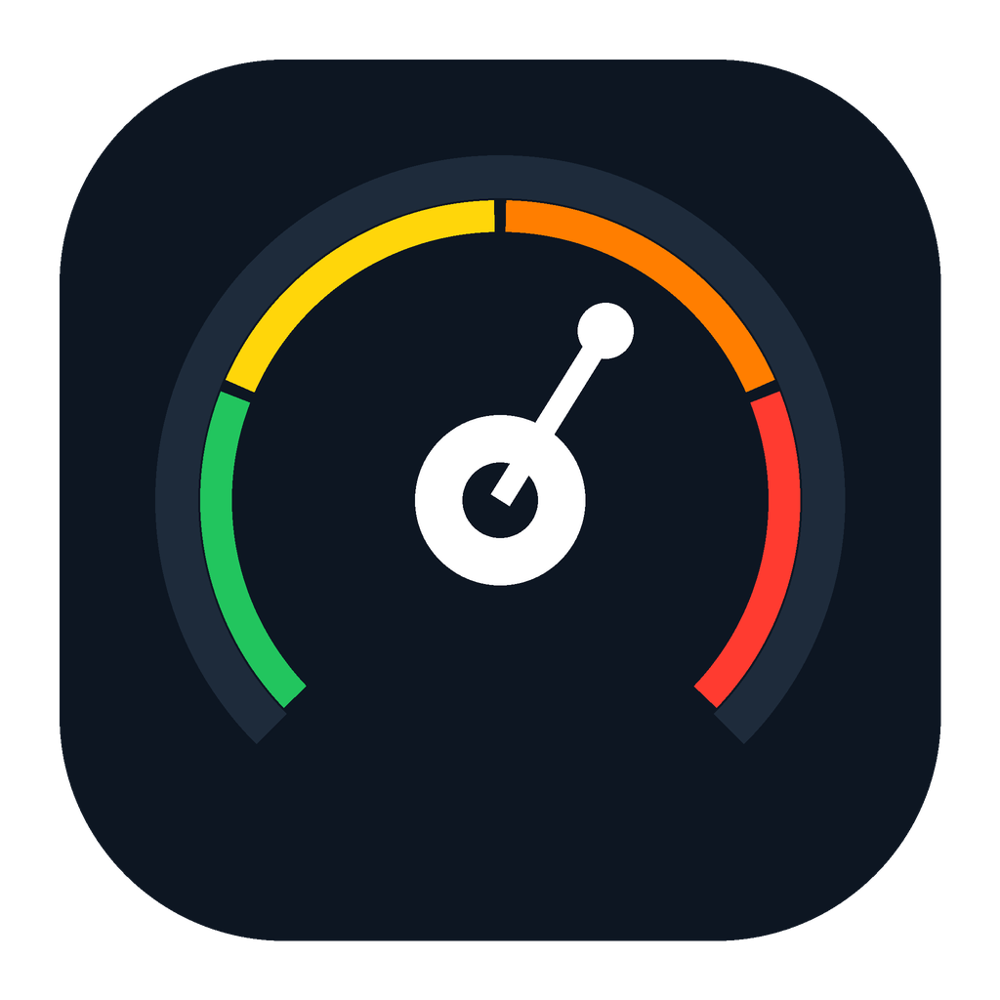

# AQI Menubar

Air quality in your **macOS menu bar** or **Windows system tray** — one number, one click
away from the station details. Data comes straight from [aqicn.org](https://aqicn.org) with
your own free API token: no account, no backend of ours, no telemetry.

| | |
|---|---|
| Platforms | macOS 11+ (Apple Silicon & Intel), Windows 10/11 |
| Stack | Tauri 2 · Rust · React + TypeScript · i18next |
| Languages | English · 简体中文 · 日本語 (auto-detected, switchable in Settings) |
| Licence | MIT |



## Install

```bash
brew install --cask z-hhh/aqi-menubar/aqi-menubar
```

or take the `.dmg` / installer from [Releases](https://github.com/z-hhh/aqi-menubar/releases/latest).
Both builds update themselves in place (signed updater artifacts from the same release feed).

The landing page lives in [`landing/`](landing) and is published to GitHub Pages by
`.github/workflows/pages.yml` — enable **Settings → Pages → Source: GitHub Actions** once.

## What it does

- **Menu bar / tray**: configurable. Pick the AQI number, the PM2.5 number, or just a
  coloured dot; add the `AQI` label and the station name or not. Settings shows a live
  preview of the result, and the change lands in the menu bar as you save.
  (Windows cannot render text in the notification area, so there the dot is the icon and
  the numbers live in the tooltip.)
- **Panel** (click the tray item): AQI badge and category, station name, station reading time,
  PM2.5 / PM10 / O₃ / NO₂ / SO₂ / CO, main pollutant, temperature, humidity and wind, and the
  full list of upstream data sources as clickable links.
- **Location**: automatic (aqicn resolves it from your IP), a city or station name, or a
  specific station picked from search.
- **Refresh interval**: 5–60 minutes. aqicn stations publish hourly, so anything faster only
  burns your quota.
- **Updates**: checked 20 seconds after launch and then every six hours, installed in place
  from the signed release feed, with a **Check for updates…** item in the tray menu.
- Data stays on your machine. If a refresh fails, the panel keeps showing the last reading and
  marks it as stale instead of going blank.

## Getting a token

The app opens on a three-step setup screen the first time it runs:

1. Open <https://aqicn.org/data-platform/token/>.
2. Enter your email and name — the token arrives immediately by email.
3. Paste it into the app.

The token is stored in plain text in the app's config file (permissions `0600`):

- macOS: `~/Library/Application Support/app.aqimenubar.desktop/config.json`
- Windows: `%APPDATA%\app.aqimenubar.desktop\config.json`

## Data source, attribution and terms

The readings are produced by the [World Air Quality Index project](https://waqi.info/) and its
contributing monitoring agencies, and served through the aqicn.org data platform API. Per the
platform's terms:

- This app is **free** and does not sell, resell or bundle the data.
- The **data sources are attributed in the panel**, using the `attributions` field returned by
  the API — including the monitoring agency that produced the reading.
- Readings are fetched live by each client with the user's own token and are **not cached or
  archived for redistribution**; the in-memory last reading exists only so the UI can show a
  stale value while a refresh is failing.
- The app is **not affiliated with or endorsed by** the World Air Quality Index project.

If you fork this and run it as a public or commercial service, read the aqicn.org API terms
yourself first — a hosted proxy that serves many users from one token is not covered by them.

## Development

Requirements: Node 20+, pnpm, Rust stable, and on macOS the Xcode command line tools
(on Windows, the MSVC build tools + WebView2).

```bash
pnpm install
pnpm tauri dev      # hot-reloading desktop app
pnpm tauri build    # .app / .dmg or .msi / .exe in src-tauri/target/release/bundle
```

The panel's frontend also runs in a plain browser against mock data, which is how the UI is
reviewed without launching the desktop app:

```bash
pnpm dev   # http://localhost:1420/?mock=empty | ?mock=data&aqi=178 | ?update=0.2.0
```

Checks:

```bash
pnpm build                      # type-check + frontend bundle
cd src-tauri && cargo test      # API parsing, URL building, colour bands, tray text
```

### Layout

```
src/                  React panel UI, i18n resources (src/locales/*.json), mock backend
src-tauri/src/
  aqicn.rs            API client + response parsing (+ unit tests)
  config.rs           Settings model (location, refresh, language, tray display) and storage
  tray.rs             Tray icon, menu, panel positioning, menu bar text composition (+ tests)
  icons.rs            EPA colour bands and the generated tray dot
  commands.rs         IPC surface: state, config, search, tray preview, updater
  lib.rs              App setup, the polling loop, the update check
landing/              Static landing page (GitHub Pages)
packaging/homebrew/   Cask, tap bump script, official-cask checklist
```

Polling is a single async loop that wakes on a timer or when settings change, fetches, updates
the tray and pushes the new state to the UI over an event. The UI never polls by itself. The
update check runs in Rust on its own timer for the same reason.

The menu bar text is composed in exactly one place (`tray::texts`); `src/aqi.ts` `trayText()`
mirrors it for the Settings preview, and both have to be changed together.

### Releasing

Tag a commit (`git tag v0.2.0 && git push --tags`). `.github/workflows/release.yml` builds a
universal macOS bundle and a Windows installer, signs the updater artifacts and opens a draft
release with `latest.json`, then bumps the Homebrew cask.

Repository secrets it needs:

| Secret | What for |
|---|---|
| `TAURI_SIGNING_PRIVATE_KEY` | signs updater artifacts (contents of `~/.tauri/aqi-menubar.key`) |
| `TAURI_SIGNING_PRIVATE_KEY_PASSWORD` | its password (empty is fine) |
| `TAP_GITHUB_TOKEN` | pushes the cask to `z-hhh/homebrew-aqi-menubar`; without it the cask job skips |

If the signing key is lost, existing installs cannot verify updates and everyone has to
download once by hand — keep it somewhere safe.

## Adding a language

1. Copy `src/locales/en.json` to `src/locales/<tag>.json` and translate the values.
2. Register it in `src/i18n.ts` (`resources` and `SUPPORTED`).
3. Add an `<option>` to the language selector in `src/Settings.tsx`.
4. Add the tag to `labels()` in `src-tauri/src/tray.rs` for the tray menu.

## Licence

MIT — see [LICENSE](LICENSE). "aqicn", "World Air Quality Index" and the data belong to their
respective owners.
