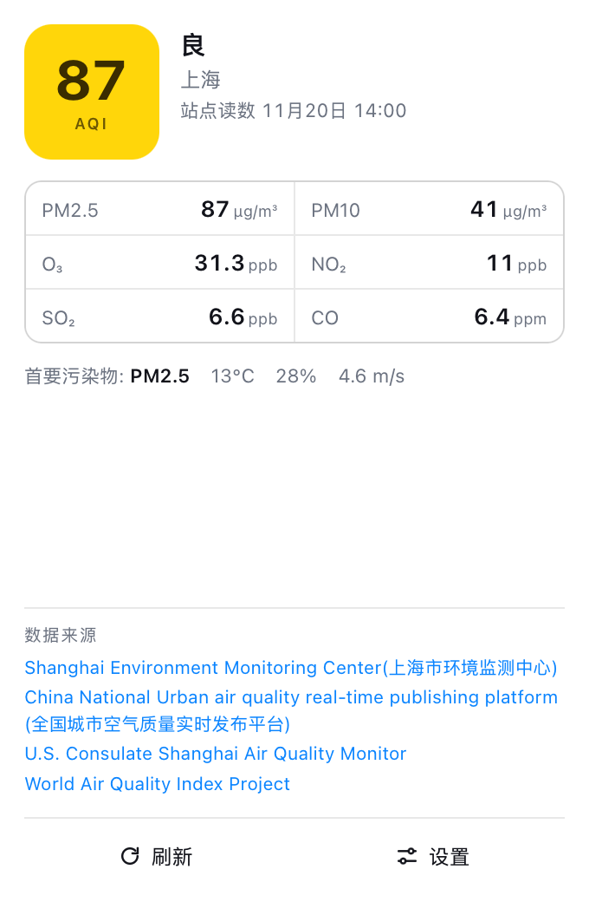
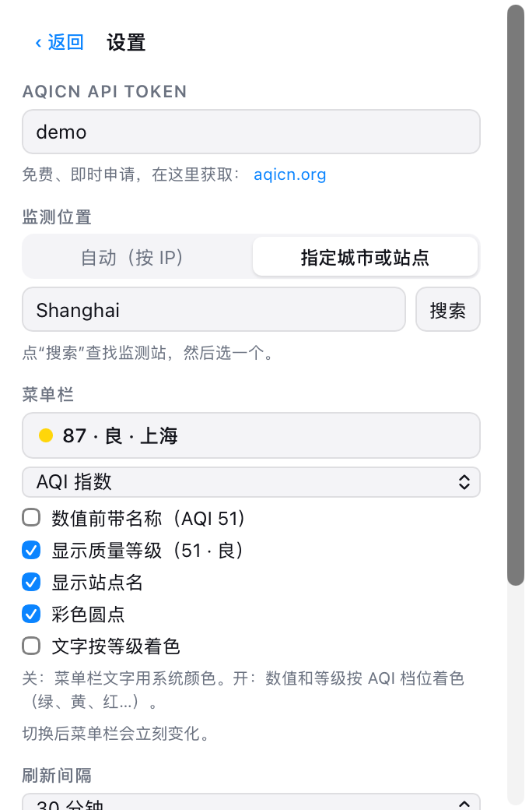
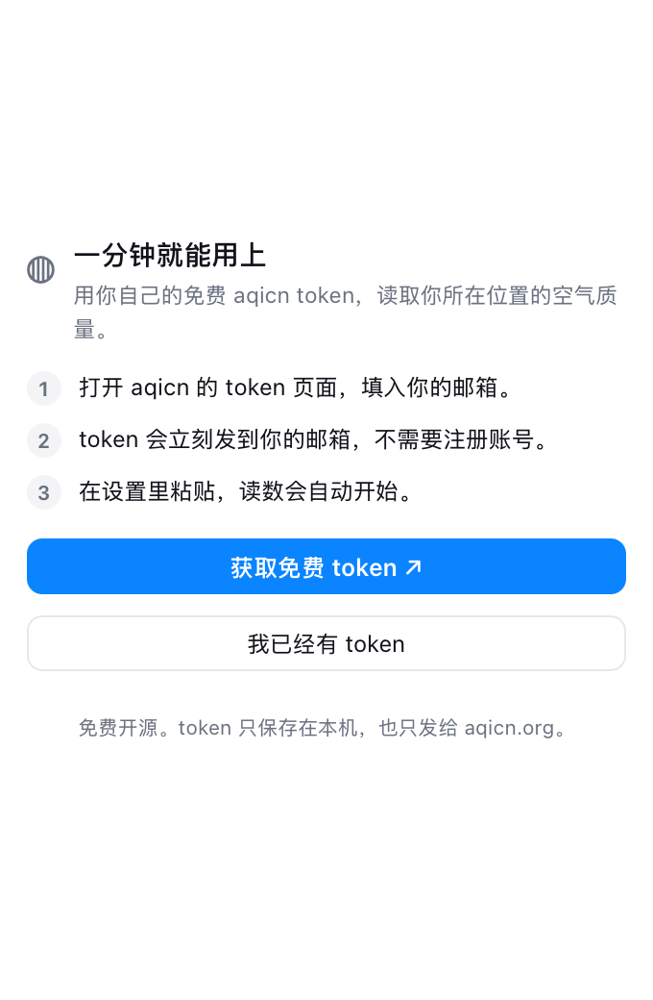
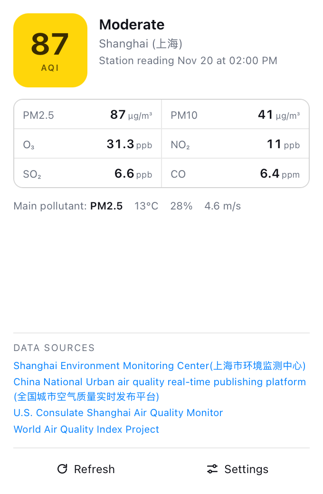

<h1 align="center">AQI Menubar</h1>

<p align="center">
  <b>简体中文</b> · <a href="README.md">English</a>
</p>

<p align="center">
  把空气质量放进 <b>macOS 菜单栏</b> 或 <b>Windows 通知区</b>——一个数字，点一下就展开站点详情。
  数据用你自己的免费 token 从 <a href="https://aqicn.org">aqicn.org</a> 直连获取：没有账号、没有我们自己的
  后端、没有埋点。
</p>

<p align="center">
  <a href="https://github.com/z-hhh/aqi-menubar/releases/latest"></a>
  
  
  <a href="https://aqi.zhhh.fun"></a>
</p>

<p align="center">
  
  &nbsp;&nbsp;
  
</p>

| | |
|---|---|
| 平台 | macOS 11+（Apple 芯片与 Intel）、Windows 10/11 |
| 技术栈 | Tauri 2 · Rust · React + TypeScript · i18next |
| 语言 | English · 简体中文 · 日本語（自动识别，可在设置里切换） |
| 许可 | MIT |

## 安装

到 [Releases](https://github.com/z-hhh/aqi-menubar/releases/latest) 下载 `.dmg`（macOS）或安装包
（Windows）。两个平台都会从签名过的发布源原地自动更新。

macOS 包是 ad-hoc 签名、未做公证，所以第一次打开会被 Gatekeeper 拦住。那个对话框只有「完成」和
「移到废纸篓」，框里没有「打开」按钮——这是被拦住，不是安装包坏了。放行办法：

1. 先在访达里双击一次应用（还在磁盘映像里的话，先拖进「应用程序」）。会被拦，这一步是为了让下一步的
   按钮出现。
2. 打开「系统设置 → 隐私与安全性」，在「安全性」一节点「打开」，再点「仍要打开」，输入开机密码。
   这个按钮只在尝试打开后一小时内出现（各版本按钮文字略有差别）。
3. macOS 14 及更早版本还有一条捷径：按住 Control 点按应用 →「打开」→「打开」。macOS 15 及以后
   已经没有这个菜单项了。
4. 如果提示「已损坏，无法打开」，说明下载不完整，重新下一遍 `.dmg`。

Windows 安装包未签名，SmartScreen 可能提示「Windows 已保护你的电脑」→「更多信息」→「仍要运行」。

[`packaging/homebrew`](packaging/homebrew) 里留了一份 cask 定义，想自建 tap 的人可以直接用。目前没有发布
——没有 Apple Developer ID（公证）的话，Homebrew 装完一样会被 Gatekeeper 拦，所以暂时不值得建 tap。

落地页源码在 [`landing/`](landing)，由 `.github/workflows/pages.yml` 发布到 GitHub Pages，线上地址是
**<https://aqi.zhhh.fun>**（自定义域名，Cloudflare 托管 `zhhh.fun`，灰云 CNAME 指向 `z-hhh.github.io`）。

## 截图

全部取自真机运行的应用，Retina 2×，不是效果图。读数是 aqicn 上海的实时数据。

| | |
|---|---|
|  |  |
| **首次启动。** 三步拿到免费 token；「我已经有 token」直接跳到输入框。 | **英文界面。** 同一套布局，等级词、单位和文案随语言切换。 |

## 功能

- **菜单栏／通知区**：可配置。数值可选 AQI、PM2.5，或只留彩色圆点；文字可选加 `AQI` 名称、加质量等级
  （`51 · 良`、`51 · Moderate`）、加站点名。等级词跟随界面语言，默认开启。文字还可以按等级着色（不开就是
  系统颜色），不要圆点也一眼可读；站点名在中／日界面优先取括号里的本地名（`Shanghai (上海)` → `上海`）。
  设置页有实时预览，改完立刻反映到菜单栏。（Windows 的通知区不能显示文字，所以那边圆点就是图标，数值和等级放在悬浮提示里。）
- **面板**（点菜单栏图标）：AQI 徽标与等级、站点名、站点读数时间、PM2.5 / PM10 / O₃ / NO₂ / SO₂ / CO、
  首要污染物、温度、湿度、风速，以及上游全部数据来源的可点击链接。
- **监测位置**：自动（aqicn 按 IP 判断）、城市或站点名，或从搜索结果里指定某个站点。
- **刷新间隔**：5–60 分钟。aqicn 的站点是每小时发布，更快只会浪费你的额度。
- **自动更新**：启动 20 秒后检查一次，之后每 6 小时一次，从签名发布源原地安装；托盘菜单里也有
  **检查更新…**。
- 数据只留在你本机。刷新失败时面板继续显示上一次读数并标记为过期，不会变空白。

## 获取 token

第一次运行会直接进入三步引导页：

1. 打开 <https://aqicn.org/data-platform/token/>。
2. 填邮箱和名字——token 会立刻发到邮箱。
3. 粘贴进应用。

token 以明文保存在应用的配置文件里（权限 `0600`）：

- macOS：`~/Library/Application Support/app.aqimenubar.desktop/config.json`
- Windows：`%APPDATA%\app.aqimenubar.desktop\config.json`

## 数据来源、署名与条款

读数由 [World Air Quality Index project](https://waqi.info/) 及其贡献监测机构产生，通过 aqicn.org
数据平台 API 提供。按该平台条款：

- 本应用**免费**，不销售、转售或打包分发数据。
- **面板内对数据来源署名**，用的是 API 返回的 `attributions` 字段——包括产生该读数的监测机构。
- 读数由每个客户端用使用者自己的 token 实时获取，**不缓存、不归档用于再分发**；内存里保留的上一次读数只是
  为了在刷新失败时显示过期值。
- 本应用**与** World Air Quality Index project **无关联、未获其背书**。

如果你 fork 后拿去做公开或商业服务，请自己先读 aqicn.org 的 API 条款——用一个 token 代理给大量用户访问
不在条款允许范围内。

## 开发

需要 Node 20+、pnpm、Rust stable；macOS 还要 Xcode 命令行工具（Windows 要 MSVC 构建工具 + WebView2）。

```bash
pnpm install
pnpm tauri dev      # 带热更新的桌面应用
pnpm tauri build    # 在 src-tauri/target/release/bundle 出 .app / .dmg 或 .msi / .exe
```

面板前端也能在普通浏览器里跑 mock 数据，这是不开桌面应用也能逐屏检查界面的方式：

```bash
pnpm dev   # http://localhost:1420/?mock=empty | ?mock=data&aqi=178 | ?update=0.2.0&lang=zh-CN
```

检查：

```bash
pnpm build                      # 类型检查 + 前端打包
cd src-tauri && cargo test      # API 解析、URL 拼装、色阶、菜单栏文字
```

两个开发用环境变量方便脚本化检查和 [`docs/screenshots`](docs/screenshots) 里的截图：
`AQI_MENUBAR_SHOW=1` 启动即打开面板，`AQI_MENUBAR_DEV_VIEW=settings` 直接打开设置页。配置里有 token 时，
在 Retina 屏上截窗口就是 2× 图——这套图就是这么来的。

### 目录结构

```
src/                  React 面板界面、i18n 文案（src/locales/*.json）、mock 后端
src-tauri/src/
  aqicn.rs            API 客户端与响应解析（含单元测试）
  config.rs           设置模型（位置、刷新、语言、菜单栏显示）与存储
  tray.rs             托盘图标、菜单、面板定位、菜单栏文字合成（含测试）
  level.rs            AQI 分档与其本地化等级词（菜单栏、圆点颜色、面板共用）
  icons.rs            EPA 色阶与生成的托盘圆点
  commands.rs         前端 IPC：状态、配置、搜索、菜单栏预览、更新
  lib.rs              应用装配、轮询循环、更新检查
docs/screenshots/     README 截图（2× PNG，落地页也用这套）
landing/              静态落地页（GitHub Pages）
packaging/homebrew/   cask、tap bump 脚本、官方 cask 提交清单
```

轮询是一条异步循环：定时器到点或设置变化时醒来，拉一次数据，更新托盘，再通过事件把新状态推给界面。界面自己
从不轮询。更新检查出于同样的原因跑在 Rust 侧的独立定时器里。

菜单栏文字只在一处合成（`tray::texts`）；`src/aqi.ts` 的 `trayText()` 为设置页预览镜像这套规则，两边必须
一起改。分档本身在 `level.rs`；前端 `src/aqi.ts` 的 `categoryOf()` 为颜色和面板镜像它。

### 发版

打个 tag（`git tag v0.2.0 && git push --tags`）。`.github/workflows/release.yml` 会构建 macOS 通用包和
Windows 安装包，给更新产物签名，并开一个带 `latest.json` 的草稿 release。

需要的仓库密钥：

| 密钥 | 用途 |
|---|---|
| `TAURI_SIGNING_PRIVATE_KEY` | 给更新产物签名（`~/.tauri/aqi-menubar.key` 的内容） |
| `TAURI_SIGNING_PRIVATE_KEY_PASSWORD` | 它的密码（可以为空） |

签名私钥一旦丢失，已安装的用户将无法验证更新，只能手动重新下载一次——请备份好。

## 新增一门语言

1. 复制 `src/locales/en.json` 为 `src/locales/<tag>.json` 并翻译值。
2. 在 `src/i18n.ts` 里注册（`resources` 与 `SUPPORTED`）。
3. 在 `src/Settings.tsx` 的语言下拉里加一个 `<option>`。
4. 在 `src-tauri/src/tray.rs` 的 `labels()` 里加上这个 tag，托盘菜单才会跟着变。

## 许可

MIT——见 [LICENSE](LICENSE)。“aqicn”、“World Air Quality Index” 及相关数据归各自所有者。
